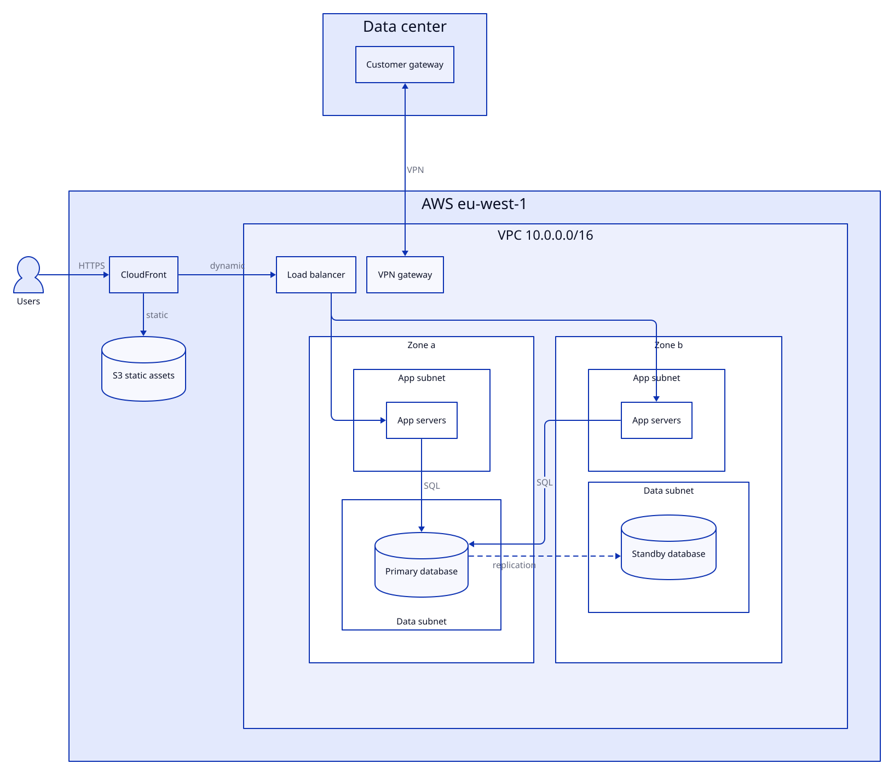
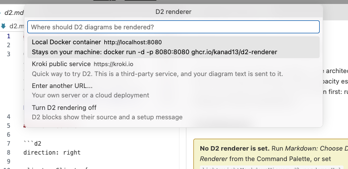
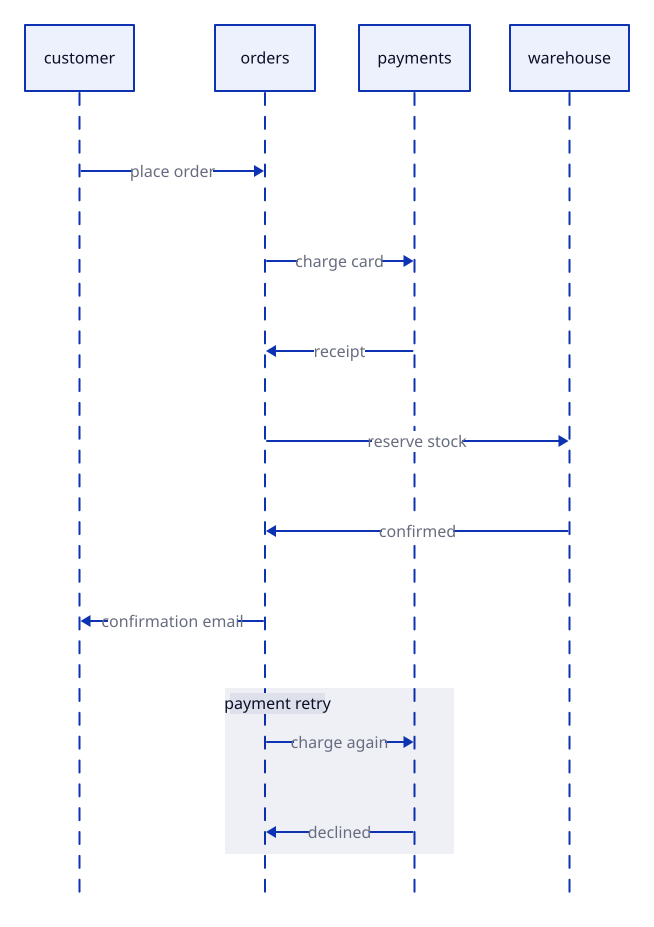
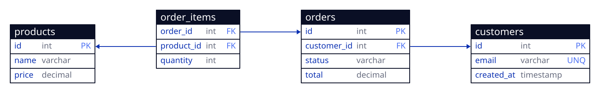
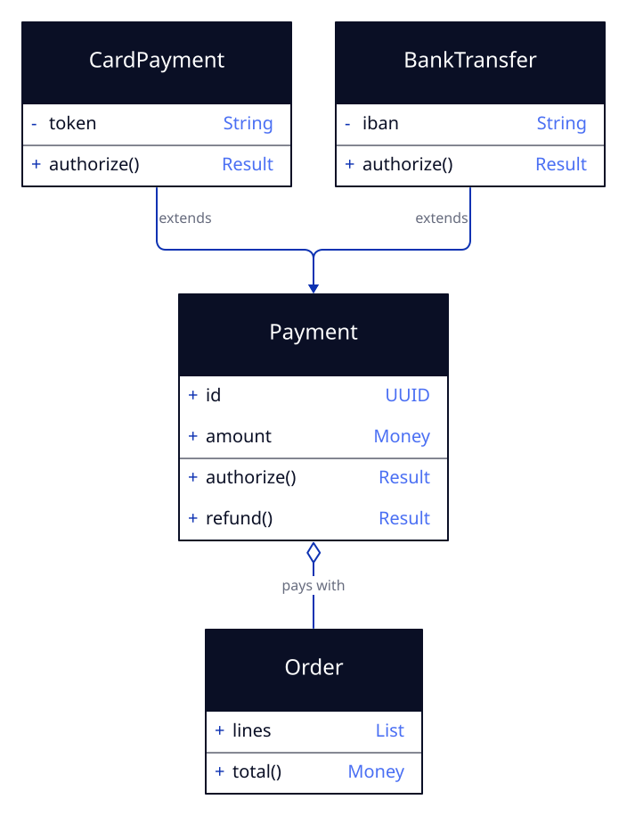
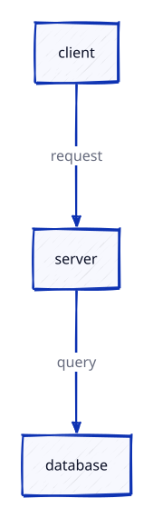
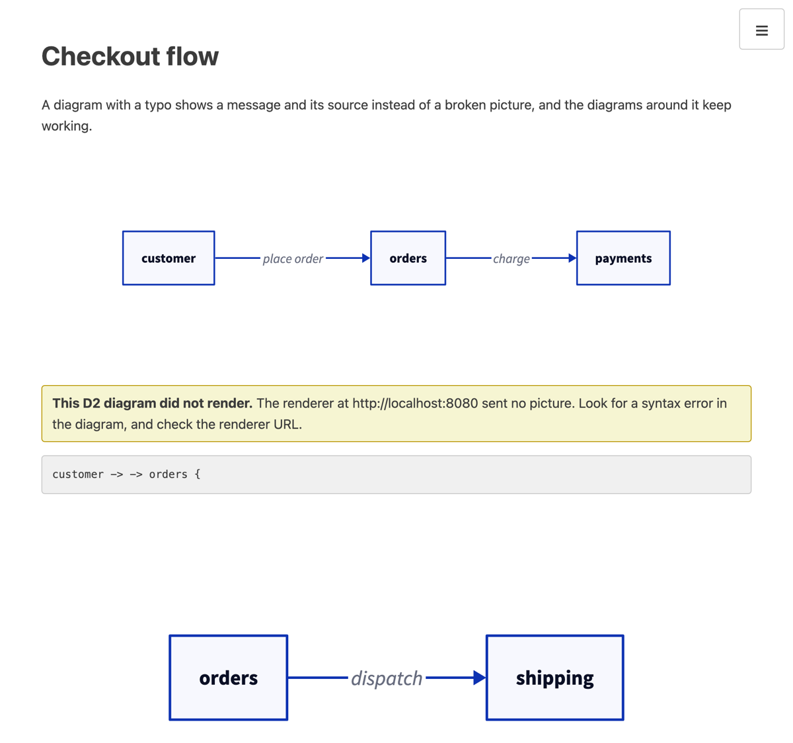

# D2 Diagrams in the Preview

[D2](https://d2lang.com) is a text language for architecture diagrams. You write boxes, containers and arrows, and a renderer draws them. GitHub and VS Code do not draw D2, so this extension draws every ` ```d2 ` fence in your Markdown preview, next to the file you are editing.

This page is both the guide and the gallery. Each example shows the D2 source followed by the picture it draws. Open this file in the preview, after the setup below, and every source block turns into a live diagram. A second, pre-drawn copy follows each one for readers who view the page elsewhere.

## A network in one diagram

Nested containers (region, VPC, zones, subnets), a grid that puts two zones side by side, shapes for people and databases, and a dashed edge for replication.

```d2
vars: {
  d2-config: {
    layout-engine: tala
    pad: 24
  }
}

users: Users {
  shape: person
}
corp: Data center {
  vpn: Customer gateway
}

aws: AWS eu-west-1 {
  cdn: CloudFront
  assets: S3 static assets {
    shape: cylinder
  }
  vpc: VPC 10.0.0.0/16 {
    alb: Load balancer
    vgw: VPN gateway
    zones: "" {
      grid-columns: 2
      style: {
        fill: transparent
        stroke: transparent
      }
      a: Zone a {
        app: App subnet {
          svc: App servers
        }
        data: Data subnet {
          db: Primary database {
            shape: cylinder
          }
        }
      }
      b: Zone b {
        app: App subnet {
          svc: App servers
        }
        data: Data subnet {
          db: Standby database {
            shape: cylinder
          }
        }
      }
    }
  }
}

users -> aws.cdn: HTTPS
aws.cdn -> aws.assets: static
aws.cdn -> aws.vpc.alb: dynamic
aws.vpc.alb -> aws.vpc.zones.a.app.svc
aws.vpc.alb -> aws.vpc.zones.b.app.svc
aws.vpc.zones.a.app.svc -> aws.vpc.zones.a.data.db: SQL
aws.vpc.zones.b.app.svc -> aws.vpc.zones.a.data.db: SQL
aws.vpc.zones.a.data.db -> aws.vpc.zones.b.data.db: replication {
  style.stroke-dash: 4
}
corp.vpn <-> aws.vpc.vgw: VPN
```



## Set it up in three steps

1. **Start a renderer.** A Docker container on your machine keeps your diagrams private:

   ```bash
   docker run -d --name d2-renderer --platform linux/amd64 -p 8080:8080 ghcr.io/kanad13/d2-renderer:latest
   ```

   The image is built for `linux/amd64`. The `--platform` flag lets Apple Silicon Macs run it, and Intel machines ignore it.

2. **Choose it.** Run **Markdown: Choose D2 Renderer** from the Command Palette and pick **Local Docker container**.

   

3. **Write a diagram** in a ` ```d2 ` fence, and open the preview.

Until step 2, a D2 fence stays an ordinary code block with one quiet hint under the first one, and documents without D2 look exactly as before.

## More examples

### A message flow

A sequence diagram with a labeled group for the retry.

```d2
vars: {
  d2-config: {
    pad: 24
  }
}

shape: sequence_diagram

customer
orders
payments
warehouse

customer -> orders: place order
orders -> payments: charge card
payments -> orders: receipt
orders -> warehouse: reserve stock
warehouse -> orders: confirmed
orders -> customer: confirmation email

payment retry: {
  orders -> payments: charge again
  payments -> orders: declined
}
```



### A database schema

Tables with typed columns and keys, and foreign keys drawn as arrows between columns.

```d2
vars: {
  d2-config: {
    layout-engine: tala
    pad: 24
  }
}

customers: {
  shape: sql_table
  id: int {constraint: primary_key}
  email: varchar {constraint: unique}
  created_at: timestamp
}
orders: {
  shape: sql_table
  id: int {constraint: primary_key}
  customer_id: int {constraint: foreign_key}
  status: varchar
  total: decimal
}
order_items: {
  shape: sql_table
  order_id: int {constraint: foreign_key}
  product_id: int {constraint: foreign_key}
  quantity: int
}
products: {
  shape: sql_table
  id: int {constraint: primary_key}
  name: varchar
  price: decimal
}

orders.customer_id -> customers.id
order_items.order_id -> orders.id
order_items.product_id -> products.id
```



### A class diagram

Classes with fields and methods, inheritance and composition.

```d2
vars: {
  d2-config: {
    layout-engine: tala
    pad: 24
  }
}

Payment: {
  shape: class
  +id: UUID
  +amount: Money
  +authorize(): Result
  +refund(): Result
}
CardPayment: {
  shape: class
  -token: String
  +authorize(): Result
}
BankTransfer: {
  shape: class
  -iban: String
  +authorize(): Result
}
Order: {
  shape: class
  +lines: List
  +total(): Money
}

CardPayment -> Payment: extends {
  target-arrowhead.shape: triangle
}
BankTransfer -> Payment: extends {
  target-arrowhead.shape: triangle
}
Order -> Payment: pays with {
  target-arrowhead.shape: diamond
}
```



## Choose a renderer

The setting `lightweightMarkdownViewer.d2.rendererUrl` holds the base URL of a Kroki-compatible renderer. The preview asks it for each diagram.

| Renderer            | URL                     | Notes                                                                                                                                                                                           |
| :------------------ | :---------------------- | :---------------------------------------------------------------------------------------------------------------------------------------------------------------------------------------------- |
| **Local Docker**    | `http://localhost:8080` | Runs D2 0.9.0 on your machine, so your diagram text stays there. Every example on this page draws with it. Source: [d2-renderer](https://github.com/kanad13/d2-renderer).                       |
| **Kroki**           | `https://kroki.io`      | A public service with nothing to install, handy for a first try. It receives your diagram text, and it runs D2 0.7.1, so the examples that name `layout-engine: tala` need the Docker renderer. |
| **Your own server** | Your `https://` URL     | Run the d2-renderer image on any container host. Its repository includes a runbook that deploys it to Google Cloud Run from GitHub Actions.                                                     |

- **Privacy:** the extension has no telemetry, and diagram text goes only to the renderer you choose.
- **Plain `http://`:** use it for `localhost` or a network you trust, because the diagram text travels in the address.
- **Your setting only:** `rendererUrl` is a user setting, so a repository you clone cannot choose where your diagrams go.

## Put options in the diagram

The extension has no layout or style settings, because D2 already has a place for them: the diagram. Write them once in `d2-config`, and the picture looks the same in the preview, in the playground and on a teammate's machine.

```d2
vars: {
  d2-config: {
    layout-engine: elk
    sketch: true
    pad: 24
  }
}

client -> server: request
server -> database: query
```



Two options deserve a note. `pad: 24` trims the 100-pixel margin that D2 adds around every diagram, so the picture fills the preview. The theme is the one option the extension sets for you: light editor themes use D2 theme 0 and dark ones use Dark Mauve (200), so diagrams match the editor, and a `theme-id` in the diagram is replaced.

## Write diagrams that read well

- **Mind the width.** The preview column is about 860 pixels wide, and wider diagrams scale down. Containers, grids and `direction: down` keep a diagram compact.
- **Keep one diagram under about a thousand lines.** The address that carries the source has a limit of 8,000 characters, and a larger diagram shows its source with a note to split it.
- **Icons work.** The renderer embeds `icon:` images into the picture. Tooltips and links do not, because they need a live page and a picture has none.
- **Edits are cheap.** On the Docker renderer, only the diagram you change asks for a new picture.

## If a diagram does not draw



| What you see                                                    | What to do                                                                                                                   |
| :-------------------------------------------------------------- | :--------------------------------------------------------------------------------------------------------------------------- |
| The D2 source in a code block, with "This is a D2 diagram"      | Run **Markdown: Choose D2 Renderer**.                                                                                        |
| A yellow box: "The D2 renderer URL is not usable"               | Set a plain `http://` or `https://` URL, with no user name, query or fragment.                                               |
| A yellow box: "This D2 diagram did not render", with the source | Check that the renderer is running and the URL is right, then fix the diagram. The D2 playground shows the compiler message. |
| A note that the diagram is too large to send                    | Split it into smaller diagrams.                                                                                              |

## Related projects

- **[d2-renderer](https://github.com/kanad13/d2-renderer):** the Docker image behind the local option. It wraps the D2 compiler in a small HTTP service, and its runbook and setup script deploy it to Google Cloud Run from GitHub Actions.
- **[d2-architect](https://github.com/kanad13/coherent-output/tree/main/skills/d2-architect):** an agent skill that adds a verified D2 diagram under every heading of a document. This preview draws what it writes.
