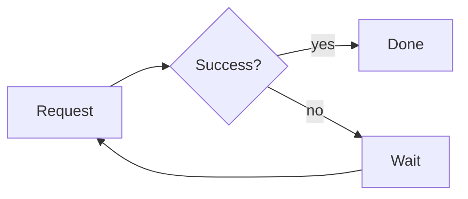

# Order service design

One document, three kinds of diagram. The network is D2, the retry policy is Mermaid, and the capacity estimate is math. Choose where D2 diagrams are drawn first: run **Markdown: Choose D2 Renderer**. The network diagram looks best with the `tala` layout, which the local Docker renderer offers (`lightweightMarkdownViewer.d2.layout`).

## Network

Nested containers (region, VPC, availability zones, subnets), a grid that puts the two zones side by side, shapes for people and databases, and a dashed edge for replication, in one diagram.

```d2
# D2 pads every diagram by 100 px; this trims it so the picture fills the preview
vars: {
  d2-config: {
    pad: 24
  }
}

users: Users {
  shape: person
}
corp: Data center {
  vpn: Customer gateway
}

aws: AWS eu-west-1 {
  cdn: CloudFront
  assets: S3 static assets {
    shape: cylinder
  }
  vpc: VPC 10.0.0.0/16 {
    alb: Load balancer
    vgw: VPN gateway
    zones: "" {
      grid-columns: 2
      style: {
        fill: transparent
        stroke: transparent
      }
      a: Zone a {
        app: App subnet {
          svc: App servers
        }
        data: Data subnet {
          db: Primary database {
            shape: cylinder
          }
        }
      }
      b: Zone b {
        app: App subnet {
          svc: App servers
        }
        data: Data subnet {
          db: Standby database {
            shape: cylinder
          }
        }
      }
    }
  }
}

users -> aws.cdn: HTTPS
aws.cdn -> aws.assets: static
aws.cdn -> aws.vpc.alb: dynamic
aws.vpc.alb -> aws.vpc.zones.a.app.svc
aws.vpc.alb -> aws.vpc.zones.b.app.svc
aws.vpc.zones.a.app.svc -> aws.vpc.zones.a.data.db: SQL
aws.vpc.zones.b.app.svc -> aws.vpc.zones.a.data.db: SQL
aws.vpc.zones.a.data.db -> aws.vpc.zones.b.data.db: replication {
  style.stroke-dash: 4
}
corp.vpn <-> aws.vpc.vgw: VPN
```

## Retry policy



## Capacity

With $\lambda$ requests per second and mean service time $s$, the load is

$$ \rho = \lambda s $$

so keep $\rho < 0.7$ to stay out of the queueing knee.

## Checkout sequence

```d2
vars: {
  d2-config: {
    pad: 24
  }
}

shape: sequence_diagram

customer -> orders: place order
orders -> payments: charge
payments -> orders: receipt
orders -> customer: confirmation
```

```python
def utilization(rate: float, service_time: float) -> float:
    return rate * service_time
```
