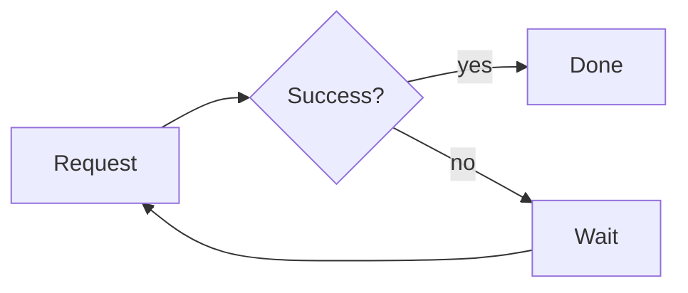

# Order service design

One document, three kinds of diagram. The architecture is D2, the retry policy is Mermaid, and the capacity estimate is math. Choose where D2 diagrams are drawn first: run **Markdown: Choose D2 Renderer**.

## Architecture

```d2
direction: right

clients: Clients {
  web: Web app
  mobile: Mobile app
}

platform: Platform {
  gateway: API gateway
  orders: Order service
  payments: Payment service
  gateway -> orders: REST
  orders -> payments: gRPC
}

db: Orders DB {
  shape: cylinder
}

clients.web -> platform.gateway: HTTPS
clients.mobile -> platform.gateway: HTTPS
platform.orders -> db: SQL
```

## Retry policy



## Capacity

With $\lambda$ requests per second and mean service time $s$, the load is

$$ \rho = \lambda s $$

so keep $\rho < 0.7$ to stay out of the queueing knee.

## Checkout sequence

```d2
shape: sequence_diagram

customer -> orders: place order
orders -> payments: charge
payments -> orders: receipt
orders -> customer: confirmation
```

```python
def utilization(rate: float, service_time: float) -> float:
    return rate * service_time
```
