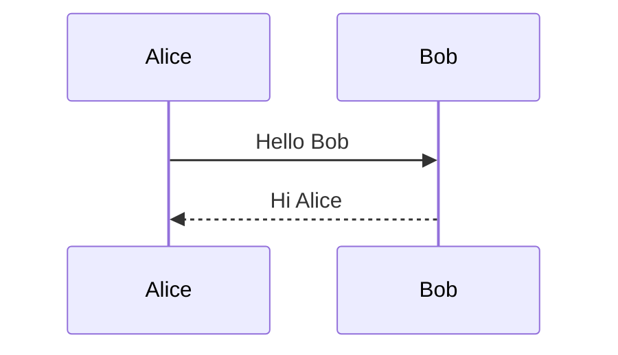

# Signal processing notes

A short note that mixes prose, math, a diagram and code. The preview renders all of it as you type.

## The idea

The discrete Fourier transform of a signal $x_n$ with $N$ samples is

$$ X_k = \sum_{n=0}^{N-1} x_n \, e^{-2\pi i k n / N} $$

and the pipeline that produces the plot looks like this:


## Code

```python
import numpy as np


def spectrum(samples):
    """Return the magnitude spectrum of a Hann-windowed signal."""
    window = np.hanning(len(samples))
    return np.abs(np.fft.rfft(samples * window))
```

## Checklist

| Step         | Owner | Status      |
| :----------- | :---- | :---------- |
| Capture data | Ana   | Done        |
| Pick window  | Ben   | In progress |
| Publish plot | Ana   | Not started |

> Prices and shell variables stay plain text: this costs $5 and $10, and `echo $HOME $PATH` is untouched.

## Same diagram, two syntaxes

GitHub style:



Azure DevOps style:

::: mermaid
sequenceDiagram
Alice->>Bob: Hello Bob
Bob-->>Alice: Hi Alice
:::
