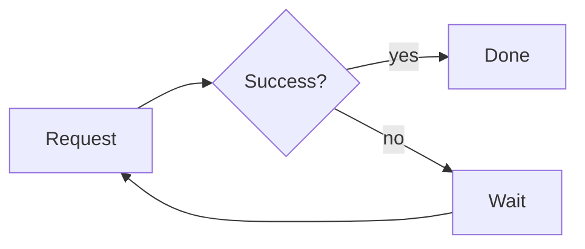
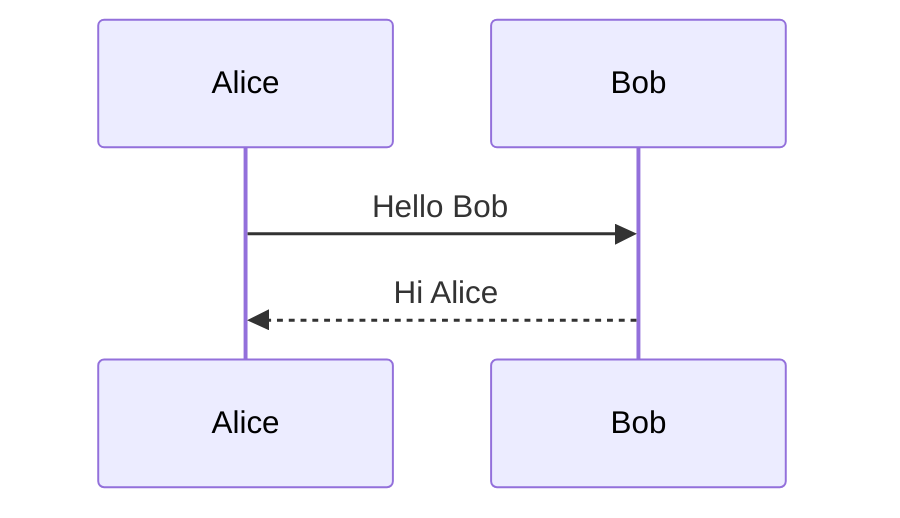

# Order service design

A short design note that mixes a D2 network diagram, Mermaid flowcharts, math and code. The preview draws all of it as you type. D2 diagrams need a renderer: run **Markdown: Choose D2 Renderer** once, and see [the D2 guide](../docs/d2.md).

## Network

```d2
vars: {
  d2-config: {
    layout-engine: tala
    pad: 24
  }
}

users: Users {
  shape: person
}
corp: Data center {
  vpn: Customer gateway
}

aws: AWS eu-west-1 {
  cdn: CloudFront
  assets: S3 static assets {
    shape: cylinder
  }
  vpc: VPC 10.0.0.0/16 {
    alb: Load balancer
    vgw: VPN gateway
    zones: "" {
      grid-columns: 2
      style: {
        fill: transparent
        stroke: transparent
      }
      a: Zone a {
        app: App subnet {
          svc: App servers
        }
        data: Data subnet {
          db: Primary database {
            shape: cylinder
          }
        }
      }
      b: Zone b {
        app: App subnet {
          svc: App servers
        }
        data: Data subnet {
          db: Standby database {
            shape: cylinder
          }
        }
      }
    }
  }
}

users -> aws.cdn: HTTPS
aws.cdn -> aws.assets: static
aws.cdn -> aws.vpc.alb: dynamic
aws.vpc.alb -> aws.vpc.zones.a.app.svc
aws.vpc.alb -> aws.vpc.zones.b.app.svc
aws.vpc.zones.a.app.svc -> aws.vpc.zones.a.data.db: SQL
aws.vpc.zones.b.app.svc -> aws.vpc.zones.a.data.db: SQL
aws.vpc.zones.a.data.db -> aws.vpc.zones.b.data.db: replication {
  style.stroke-dash: 4
}
corp.vpn <-> aws.vpc.vgw: VPN
```

## Retry policy



## Capacity

With $\lambda$ requests per second and mean service time $s$, the load is

$$ \rho = \lambda s $$

so keep $\rho < 0.7$ to stay out of the queueing knee.

## Code

```python
def utilization(rate: float, service_time: float) -> float:
    """Return the load on one server."""
    return rate * service_time
```

## Same diagram, two syntaxes

GitHub style:



Azure DevOps style:

::: mermaid
sequenceDiagram
Alice->>Bob: Hello Bob
Bob-->>Alice: Hi Alice
:::

## Checklist

| Step         | Owner | Status      |
| :----------- | :---- | :---------- |
| Draw network | Ana   | Done        |
| Pick limits  | Ben   | In progress |
| Publish note | Ana   | Not started |

> Prices and shell variables stay plain text: this costs $5 and $10, and `echo $HOME $PATH` is untouched.
