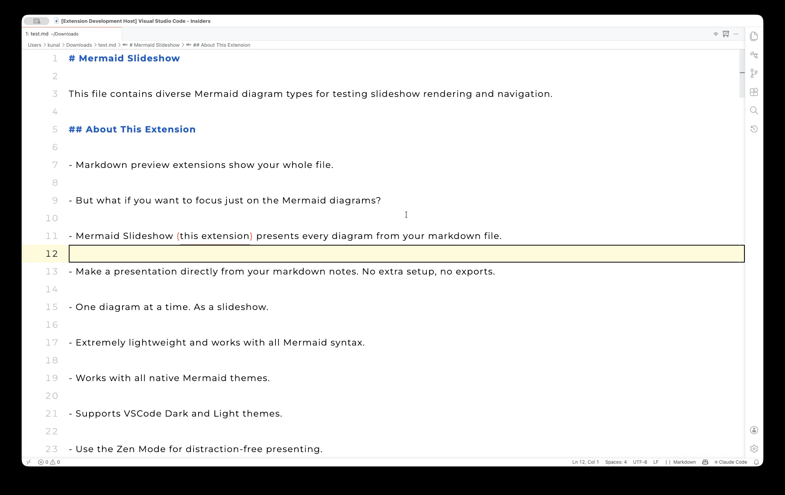
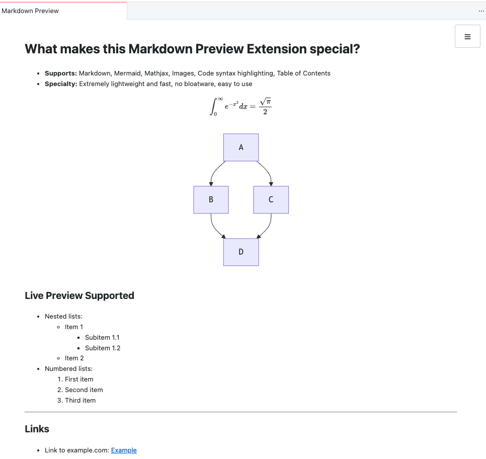

# Lightweight Markdown Preview

A small VS Code extension that previews Markdown with Mermaid diagrams and MathJax equations. It needs no configuration.



## Overview

The extension adds one command that opens a live preview beside your Markdown file.

- **What you get:**
  - A preview that updates as you type and follows the Markdown file you are editing.
  - An outline sidebar for jumping between sections.
  - Mermaid diagrams, LaTeX math, and highlighted code.
- **What you do not get:**
  - Settings, themes, or plugins. The preview follows your VS Code color theme.
- **Why it is small:**
  - One bundled dependency, the `marked` parser.
  - Mermaid, MathJax, and highlight.js load from a CDN when a preview opens.

## Install

1. Open the Extensions view in VS Code.
2. Search for "Lightweight Markdown Preview", or for the identifier `KunalPathak.lightweight-markdown-preview`.
3. Select **Install**.

**VS Code forks:**

- Editors such as Cursor read extensions from the Open VSX registry, where this extension is not listed.
- Download the `.vsix` file from the [GitHub releases](https://github.com/kanad13/lightweight-markdown-preview/releases) and run **Extensions: Install from VSIX...**.

**Requirements:**

- VS Code, or a compatible fork, released within the last 12 months.
- Network access to the jsDelivr CDN for diagrams, math, and syntax highlighting.

## Use

1. Open a Markdown file.
2. Select the eye icon in the top-right of the editor title bar. You can also open the Command Palette (`Ctrl+Shift+P` or `Cmd+Shift+P`) and run **Markdown: Show Lightweight Markdown Preview**.
3. Edit the file. The preview updates after a short pause.
4. Switch to another Markdown file. The preview switches with you and starts at the top of that file.

## Features



- **Live preview:**
  - Updates as you type.
  - Keeps your reading position while you edit.
  - Follows the active Markdown editor.
- **Outline sidebar:**
  - Opens from the ☰ button and closes with the ✕ button, the backdrop, or `Esc`.
  - Shows heading levels with `#` prefixes and collapses sections that have children.
  - Highlights the section you are reading and expands its parents.
  - Scrolls to a heading when you select it.
- **Markdown:**
  - Renders headings, lists, tables, code blocks, images, and links.
  - Resolves relative and workspace-root image paths.
- **Mermaid diagrams:**
  - Renders GitHub-style fences (` ```mermaid `).
  - Renders Azure DevOps-style fences (`::: mermaid`).
- **Math:**
  - Renders block equations (`$$ ... $$`).
  - Renders inline equations (`$ ... $`).
- **Code:**
  - Highlights fenced code blocks.
- **Themes:**
  - Matches light, dark, and high-contrast VS Code themes.
  - Re-renders when you change the theme.

## Mermaid on GitHub and Azure DevOps

GitHub uses backtick fences for Mermaid diagrams, and Azure DevOps uses triple-colon "fenced div" syntax. A diagram written for one platform does not render on the other.

- **This extension:**
  - Renders both syntaxes the same way.
  - Lets you keep one source file and preview it before you publish to either platform.

## Privacy and Security

- **Privacy:**
  - The extension sends no telemetry or analytics.
  - Your document text stays on your machine.
  - jsDelivr sees the requests for the Mermaid, MathJax, and highlight.js files, not your content.
- **Security:**
  - A Content Security Policy runs only scripts that carry a per-render random nonce.
  - The extension escapes text it inserts into the page.
  - Mermaid runs at its strict security level.

## Contribute

Start with the documents below. Each one answers a different question.

- **Understand the design:** [architecture.md](docs/architecture.md) explains the structure and the security model.
- **Work with dependencies:** [dependencies.md](docs/dependencies.md) sets the rules for choosing and reviewing versions.
- **Build and release:** [development.md](docs/development.md) covers setup and publishing.
- **Pick a task procedure:** [workflows.md](docs/workflows.md) maps each kind of request to its steps.
- **Test:** [testing.md](docs/testing.md) maps workflows to checks and lists the manual smoke check.
- **Check past decisions:** [feature-decisions.md](docs/feature-decisions.md) lists ideas that were evaluated and not built.
- **See what changed:** [CHANGELOG.md](CHANGELOG.md) lists changes by version.
- **Work as an AI agent:** [AGENTS.md](AGENTS.md) holds the shared instructions.
